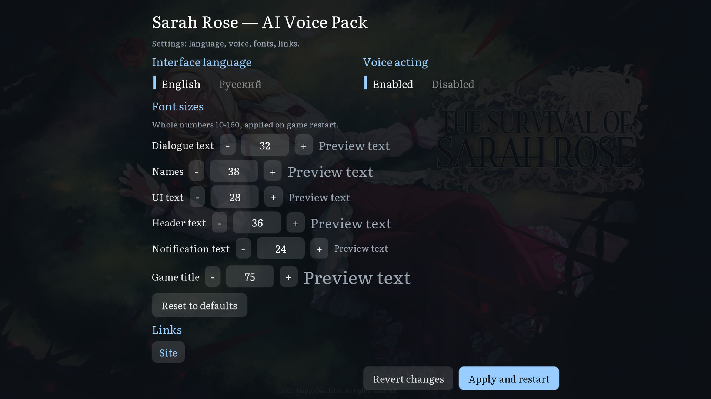
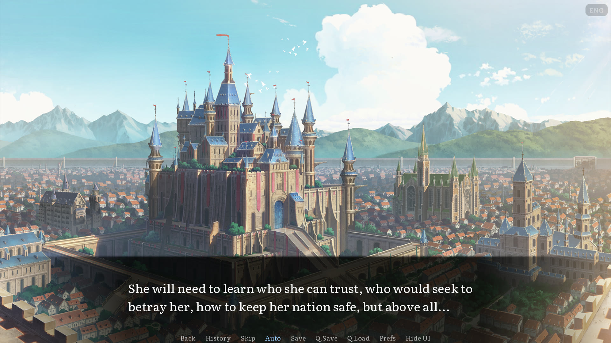
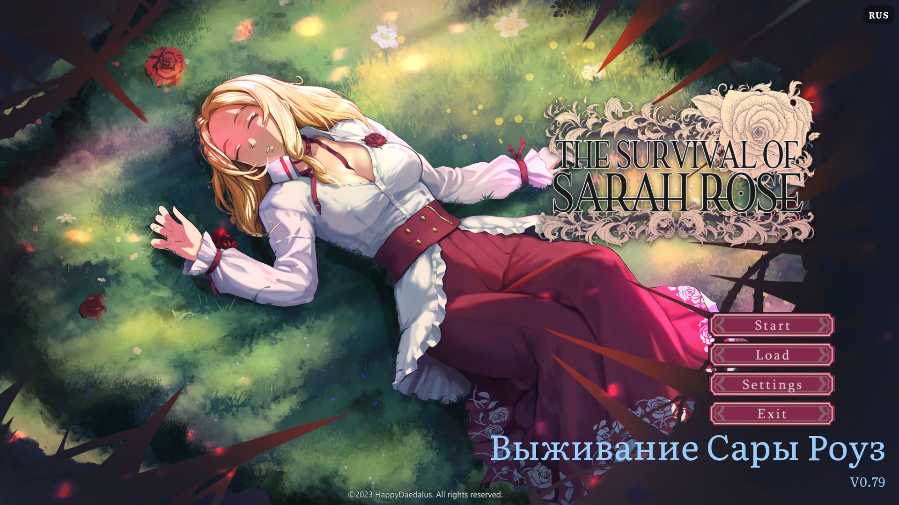
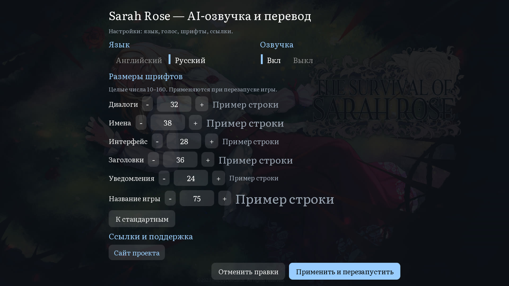
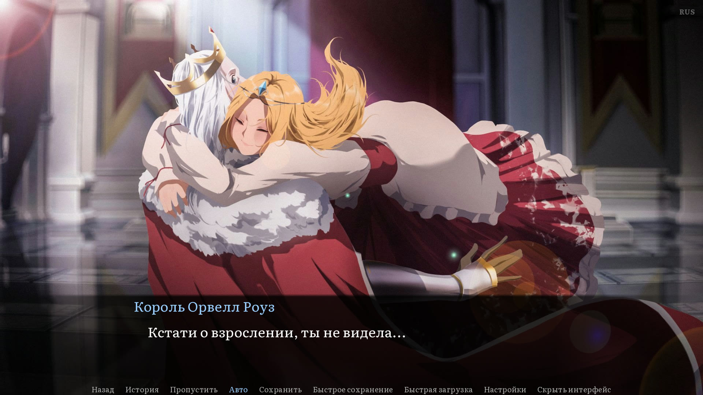
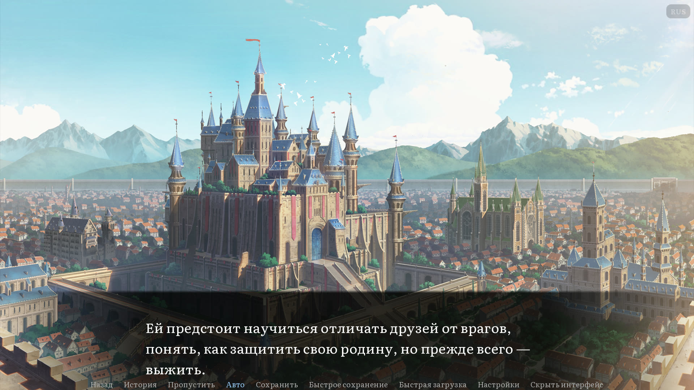

# The Survival of Sarah Rose — AI Voice Pack + Russian Localization / Русификатор + AI-озвучка

**English · [Русский](#русская-версия)**

Full Russian fan translation + AI voice acting for the visual novel **The Survival of Sarah Rose** (Ren'Py, Steam).
Полный русский перевод + AI-озвучка визуальной новеллы **The Survival of Sarah Rose** (Ren'Py, Steam).

- 68 254 lines translated / 68 254 строки переведено
- AI voice pack in two languages (RU + EN) / AI-озвучка на двух языках (RU + EN)
- 75+ characters with cloned voices / 75+ персонажей с клонированными голосами
- Emotion-aware delivery / эмоциональная озвучка каждой реплики
- Free, open source, CC BY-NC 4.0 / бесплатно, открытый код

---

# English

[Download](#download) • [Installation](#installation) • [Voice pack](#voice-pack) • [Screenshots](#screenshots) • [FAQ](#faq)

## Features

- 🌐 **Full Russian translation** — 68 254 lines: dialogues, narration, UI, character names
- 🎙 **AI voice acting (RU + EN)** — cloned voices for every main character, the game becomes fully voiced
- 🎭 **Emotion-aware delivery** — every line carries the speaker's emotional state (anger, desire, whisper, sarcasm, ...)
- 🗣 **75+ voices** — Sarah, Narrator, King Orwell, Kate, Thomas and dozens more
- 🔊 **Two languages** — switch language in-game, the voice pack follows automatically
- ⚙️ **Ren'Py 7.4.11** — works with the Steam version of the game

## Download

[**⬇ Releases**](https://github.com/Domovikx/The-Survival-of-Sarah-Rose-Mods/releases) — ready-to-install zips (main + per-language voice packs).

> **Files:** `TSSR-AI-Voice-Pack-main.zip` (core: mod + translation, ~16 MB) and optional `voice-ru` / `voice-en` packs (~0.8 GB each). Without a voice pack the game runs fully translated, just unvoiced.

## Installation

1. Unpack `main.zip` into the game folder
   (Steam default: `C:\Program Files (x86)\Steam\steamapps\common\The Survival of Sarah Rose\`)
2. Unpack the voice pack zip(s) you want into the same folder (creates `ai_voice/`)
3. If the game is **not** in the default Steam path — edit `environment.txt` (text editor) and fix the path to the `mod` folder
4. Launch the game, in settings select **Language → Russian** (or English — voices follow the language)

> First launch after installation may be slower (Ren'Py cache rebuild).

## Voice pack

The voice pack is generated with **CosyVoice3** (voice cloning) and covers both languages.
Lines are stored as **Opus 24 kbps mono** — ~16× smaller than the intermediate WAV
(24 kHz/16-bit mono, 384 kbps; measured: 20 914 MB of WAV → 1 307 MB of Opus):

- **Russian (RU)** — `ai_voice/ru/...` — **100%** ✓ (67 267 / 67 267)
- **English (EN)** — `ai_voice/en/...` — **100%** ✓ (67 267 / 67 267)

Overall: **100% voiced** (134 534 / 134 534 lines), pack size ≈ 1.6 GB.

**Completed 2026-10-18:** every line of the game is voiced in both languages —
all 19 arcs × RU + EN.

- Voice lookup is automatic: `uid = md5(text)` → `ai_voice/{lang}/{arc}/{uid}__{voice}.opus`
  (`.wav` remains a code-level fallback, but since 2026-10-14 the pack is
  Opus-only — no `.wav` files ship in `ai_voice/`)
- Every line has an emotion instruction (state of the narrator/speaker)
- Fallback: if a file is missing, the game plays silently (no crashes)

> ⚠ The voice pack is ~1.6 GB (Opus 24 kbps). Check disk space.

## Contents

### Translated arcs (all 19)

Prologue, StoryBeginnings, WarriorPath, MagePath, UnionKingdom, HollowWorld, BlackMonolith, HassarPath, SailorPath, SailorArc, LifeInRahayal, VargaMarionPath, Training, PrisonArc, AlfredArc, DemonArc, WarArc, HyralArc, Other — **68 254 lines total**.

### Voiced characters (75+)

Sarah, Narrator, King Orwell Rose, Kate, Thomas, Varga, Captain Belmont, Alaric, Carolyn, Marion, Kravel, Barion, Basilisk and many more — every character has a unique cloned voice with emotional delivery.

## Screenshots

## FAQ

### What is this?

An unofficial fan **Russian localization** (русификатор) for the visual novel **The Survival of Sarah Rose**, plus an **AI voice pack** that fully voices the game in Russian and English.

### How do I install the Russian translation / русификатор?

Unpack the zips into the game folder (see Installation), select Language → Russian in settings, clear Ren'Py cache if text is not showing.

### How does the voice acting work?

Voices are cloned from custom reference recordings with CosyVoice3 and generated for every line in both languages. The game loads `ai_voice/{lang}/{arc}/{uid}__{voice}.opus` automatically (Opus-only since 2026-10-14; `.wav` is still a code fallback but ships no files).

### Is the translation official?

No — this is an unofficial fan project, not affiliated with the developers or publishers.

### Does it contain adult content?

**Yes — 18+.** The game contains explicit adult material. Download and play only if you are **18 or older**. Keep it away from minors; you are responsible for complying with your local laws (see [LICENSE](LICENSE)).

### License?

**CC BY-NC 4.0** — free to share and adapt with attribution, non-commercial only.

### How to help?

Open an issue or submit a pull request on GitHub.

---

# Русская версия

[Скачать](#скачать) • [Установка](#установка) • [Озвучка](#озвучка) • [Скриншоты](#скриншоты) • [FAQ](#faq-1)

## Возможности

- 🌐 **Полный русский перевод** — 68 254 строки: диалоги, нарратив, интерфейс, имена персонажей
- 🎙 **AI-озвучка (RU + EN)** — клонированные голоса всех главных героев, игра становится полностью озвученной
- 🎭 **Эмоциональная подача** — каждая реплика несёт состояние диктора (гнев, страсть, шёпот, сарказм...)
- 🗣 **75+ голосов** — Сара, Рассказчик, Король Орвелл, Кейт, Томас и десятки других
- 🔊 **Два языка** — переключай язык в игре, озвучка подстраивается автоматически
- ⚙️ **Ren'Py 7.4.11** — работает со Steam-версией игры

## Скачать

[**⬇ Релизы**](https://github.com/Domovikx/The-Survival-of-Sarah-Rose-Mods/releases) — готовые zip'ы к установке (ядро + озвучка по языкам).

> **Файлы:** `TSSR-AI-Voice-Pack-main.zip` (ядро: мод + перевод, ~16 МБ) и опциональные паки `voice-ru` / `voice-en` (~0.8 ГБ каждый). Без voice-пака игра работает полностью переведённой, просто без озвучки.

## Установка

1. Распакуйте `main.zip` в папку с игрой
   (Steam: `C:\Program Files (x86)\Steam\steamapps\common\The Survival of Sarah Rose\`)
2. Распакуйте нужные voice-зипы туда же (появится папка `ai_voice/`)
3. Если игра стоит не в стандартном Steam-пути — откройте `environment.txt` текстовым редактором и поправьте путь к папке `mod`
4. Запустите игру, в настройках выберите **Language → Russian** (или English — озвучка подстроится)

> Первый запуск после установки может быть медленнее (пересборка кэша Ren'Py).

## Озвучка

Озвучка создана на **CosyVoice3** (клонирование голоса) и покрывает оба языка.
Реплики хранятся в формате **Opus 24 кбит/с моно** — примерно в 16 раз меньше
промежуточного WAV (24 кГц/16 бит моно, 384 кбит/с; замер: 20 914 МБ WAV →
1 307 МБ Opus):

- **Русский (RU)** — `ai_voice/ru/...` — **100%** ✓ (67 267 / 67 267)
- **Английский (EN)** — `ai_voice/en/...` — **100%** ✓ (67 267 / 67 267)

Итого: **озвучено 100%** (134 534 / 134 534 реплик), размер пака ≈ 1.6 ГБ.

**Завершено 18.10.2026:** озвучена каждая реплика игры на обоих языках —
все 19 арок × RU + EN.

- Поиск голоса автоматический: `uid = md5(текста)` → `ai_voice/{lang}/{arc}/{uid}__{voice}.opus`
  (`.wav` играет как фолбэк в коде, но с 2026-10-14 пак только Opus —
  `.wav`-файлов в `ai_voice/` больше нет)
- У каждой реплики есть эмоция — состояние диктора/рассказчика
- Если файла нет — игра просто играет без звука (без ошибок)

> ⚠ Озвучка — ~1.6 ГБ (Opus 24 кбит/с). Следи за местом на диске.

## Содержание

### Переведённые арки (все 19)

Prologue, StoryBeginnings, WarriorPath, MagePath, UnionKingdom, HollowWorld, BlackMonolith, HassarPath, SailorPath, SailorArc, LifeInRahayal, VargaMarionPath, Training, PrisonArc, AlfredArc, DemonArc, WarArc, HyralArc, Other — **68 254 строки**.

### Озвученные персонажи (75+)

Сара, Рассказчик, Король Орвелл, Кейт, Томас, Варга, Капитан Бельмонт, Аларик, Кэролин, Марион, Кравэл, Барион, Базилиск и многие другие — у каждого уникальный клонированный голос с эмоциональной подачей.

## Скриншоты

## FAQ

### Что это?

Неофициальный фанатский **русификатор** визуальной новеллы **The Survival of Sarah Rose**, плюс **AI-озвучка**, которая полностью озвучивает игру на русском и английском.

### Как установить русификатор?

Распакуйте зипы в папку с игрой (см. Установка), выберите в настройках русский язык, при необходимости очистите кэш Ren'Py.

### Как работает озвучка?

Голоса клонированы с референсных записей через CosyVoice3 и сгенерированы для каждой реплики на обоих языках. Игра автоматически подгружает `ai_voice/{lang}/{arc}/{uid}__{voice}.opus` (с 2026-10-14 пак только Opus; `.wav` — фолбэк в коде без файлов).

### Это официальный перевод?

Нет — неофициальный фанатский проект, не связанный с разработчиками и издателями.

### В игре есть взрослый контент?

**Да — 18+.** Игра содержит откровенные взрослые материалы. Скачивайте и играйте, только если вам **18 лет и больше**. Не допускайте к материалу несовершеннолетних; вы несёте ответственность за соблюдение законов вашей страны (см. [LICENSE](LICENSE)).

### Лицензия?

**CC BY-NC 4.0** — свободное распространение и адаптация с указанием авторства, только некоммерческое использование.

### Как помочь проекту?

Откройте issue или сделайте pull request на GitHub.

---

## О проекте / Project

- **Репозиторий / Repository:** [github.com/Domovikx/The-Survival-of-Sarah-Rose-Mods](https://github.com/Domovikx/The-Survival-of-Sarah-Rose-Mods)
- **Сайт проекта / Project site:** [domovikx.github.io/The-Survival-of-Sarah-Rose-Mods](https://domovikx.github.io/The-Survival-of-Sarah-Rose-Mods/)
- **Игра в Steam / Game on Steam:** [The Survival of Sarah Rose](https://store.steampowered.com/app/2166470/The_Survival_of_Sarah_Rose/)
- **Issues:** [github.com/Domovikx/The-Survival-of-Sarah-Rose-Mods/issues](https://github.com/Domovikx/The-Survival-of-Sarah-Rose-Mods/issues)

---

## Для разработчиков / For developers

- Структура репы: `patches/ai-voice-pack/{mod, tl, audio, tools}` (патч), `site/` (лендинг, vite + GitHub Pages), `tasks/` (журналы задач), `docs/`.
- Конвейер патча: `extract → generate → build → deploy` (см. `AGENTS.md` — архитектура озвучки, uid = md5(old)).
- Сборка дистрибутива: `npm run build:pack` → `dist/*.zip` (раскладка zip = раскладка установки).
- Линты: `npm run lint:md` (markdownlint), `npm run format` (prettier), `npm run spell` (cSpell). Pre-commit — lint-staged (husky).
- Лендинг: `cd site && npm install && npm run build` → деплой в ветку `gh-pages` (GitHub Pages).

---

## SEO / Ключевые слова (для поиска)

**Also known as / Также известен как:** TSSR · Сара Роуз · Sarah Rose русификатор ·
The Survival of Sarah Rose russian · The Survival of Sarah Rose translation ·
The Survival of Sarah Rose voice acting · озвучка Сара Роуз.

**Keywords (RU):** русификатор The Survival of Sarah Rose · перевод на русский ·
русская озвучка · голосовое озвучивание · AI-озвучка · клонирование голоса ·
визуальная новелла · Ren'Py · мод для игры · фанатский перевод · полностью
озвученная игра · 18+ новелла · Steam визуальная новелла русский.

**Keywords (EN):** The Survival of Sarah Rose russian localization · russian patch ·
fan translation · AI voice acting · fully voiced · voice pack · CosyVoice ·
visual novel · Ren'Py mod · Steam visual novel · TSSR.

---

## Лицензия и отказ от ответственности / License & Disclaimer

**Файлы перевода** (`patches/ai-voice-pack/tl/ru/`) и **озвучка** (`patches/ai-voice-pack/audio/`) распространяются под лицензией [Creative Commons BY-NC 4.0](https://creativecommons.org/licenses/by-nc/4.0/) — свободное использование и распространение с указанием авторства, только некоммерческое. / Translation files and the voice pack are distributed under the [Creative Commons BY-NC 4.0](https://creativecommons.org/licenses/by-nc/4.0/) license.

**18+:** Игра содержит откровенный взрослый контент — используя проект, вы подтверждаете, что вам 18+. / The game contains explicit adult content — by using this project you confirm you are 18+.

**Отказ от ответственности:** неофициальная фанатская работа. Все права на оригинальную игру принадлежат её правообладателям. Используйте на свой страх и риск. / This is an unofficial fan work. All rights to the original game belong to its rights holders. Use at your own risk.
